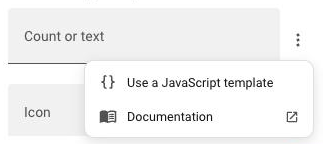
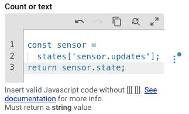

# JavaScript templates

JavaScript templates let you replace a configuration value with JavaScript code that dynamically determines its value. This allows you to customize how navbar-card behaves based on Home Assistant states, user context, or other conditions.

Look for fields marked as `JSTemplate` in the [**configuration**](../configuration/overview.md) tables to see which values support JavaScript templates.

!!! info
    Not to be confused with [navbar templates](navbar-templates.md), which allows you toreuse the same navbar configuration on all your dashboards.

## Template syntax

=== "Visual editor (recommended)"

    Only fields marked as `JSTemplate` support it. Open the menu of one of them and click **Use a JavaScript template**. The field becomes a code editor, where you write the code without `[[[` and `]]]`.

    <div class="nc-pair" markdown>

    

    

    </div>

=== "YAML"

    Wrap your JavaScript code in `[[[` and `]]]`:

    ```yaml
    badge:
      count: |
        [[[
          const sensor =
            states['sensor.updates'];
          return sensor.state;
        ]]]
    ```

---

## Available context

Your JavaScript templates have access to these predefined variables:

| Variable | Content                                                                           | Description                     |
| -------- | --------------------------------------------------------------------------------- | ------------------------------- |
| `states` | [HA `states`](https://developers.home-assistant.io/docs/frontend/data#hassstates)   | Global state of all HA entities |
| `user`   | [HA `user` state](https://developers.home-assistant.io/docs/frontend/data#hassuser) | Current user information        |
| `hass`   | [HA `hass` object](https://developers.home-assistant.io/docs/frontend/data)       | Home Assistant instance         |
| `navbar` | `{isDesktop: boolean}`                                                            | Navbar Card internal state      |

### States object

The state and attributes of any entity, e.g. a badge shown while the kitchen light is on:

```yaml
badge:
  show: |
    [[[ return states['light.kitchen'].state === 'on'; ]]]
```

Attributes work the same way, e.g. `states['light.kitchen'].attributes.brightness`.

### User object

The current user (`user.name`, `user.id`, `user.is_admin`, `user.is_owner`), e.g. a route only admins can see:

```yaml
hidden: |
  [[[ return !user.is_admin; ]]]
```

### Navbar object

The card's own state (`navbar.isDesktop`), e.g. a label only shown on desktop:

```yaml
label: |
  [[[ return navbar.isDesktop ? 'Settings' : ''; ]]]
```

---

## Debugging tips

1. **Use Console Logging**. Open the browser console (F12) to debug your templates.

    ```javascript
    [[[
      console.log('States:', states);
      console.log('User:', user);
      console.log('Navbar:', navbar);
      return 'Debug Mode';
    ]]]
    ```

2. **Error Handling**. Use try/catch to handle errors in your templates.

    ```javascript
    [[[
      try {
        // Your code here
        return 'Success';
      } catch (error) {
        console.error('Template Error:', error);
        return 'Error';
      }
    ]]]
    ```
