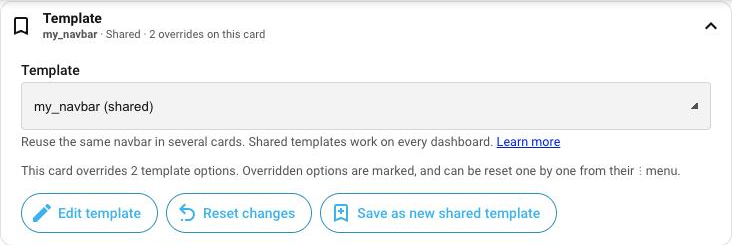
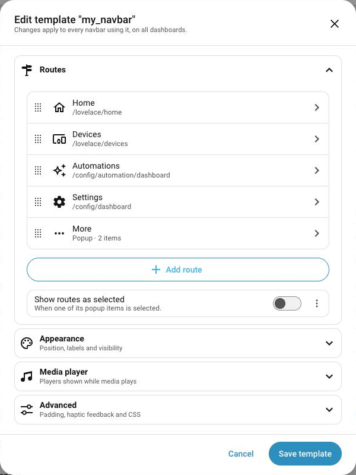
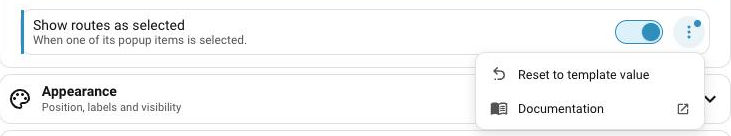

A template is a navbar configuration you set up once and reuse in as many navbars as you want, on all your Home Assistant dashboards. Change the template, and every navbar using it changes too.

!!! info
    Not to be confused with [JavaScript templates](js-templates.md), which allows you to use custom JavaScript code to change a value dynamically, like a badge count.

## Create and use a template

=== "Visual editor (recommended)"

    1. Set up a navbar the way you want it.
    2. In its **Template** section, click **Save as new shared template** and give it a name.
    3. In any other navbar, on any dashboard, pick that name in the **Template** dropdown.

    

    To change a template, click **Edit template** in any navbar using it. Your changes apply to all those navbars when you click **Save template**.

    { width="400" }

    !!! note
        Only administrators can create or edit templates. They are stored in a dashboard named **Navbar Card templates [don't delete]**, hidden from the sidebar. Deleting it deletes your templates.

=== "YAML (deprecated)"

    !!! warning
        Templates defined in YAML only work on the dashboard that defines them, and can't be edited from the visual editor. To turn one into a regular template, open a navbar using it and click **Move to shared templates**.

    Open your dashboard in edit mode, click the three dots in the top right corner and select **Raw configuration editor**. Add your templates under `navbar-templates`:

    ```yaml
    navbar-templates:
      your_template_name:
        # Your navbar config
        routes:
          - label: Home
            icon: mdi:home
            url: /lovelace/home
          ...
    # Your normal lovelace configuration
    views:
    ...
    ```

    Then reference the template from your navbars:

    ```yaml
    type: custom:navbar-card
    template: your_template_name
    ```

    If a YAML template and a template from the visual editor share a name, the YAML one is used.

## Customize a single navbar

You can override any template value for an individual navbar by setting that option directly in its configuration. All other options continue to use the template's values. 

In the visual editor, options that differ from the template are marked with a colored bar. To restore an option to its template value, open its **⋮** menu and select **Reset to template value**.



In YAML, add the options to change next to `template`. For example, a navbar using `your_template_name` with a red primary color:

```yaml
type: custom:navbar-card
template: your_template_name
styles: |
  .navbar {
    --navbar-primary-color: red;
  }
```
