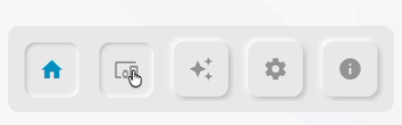

# Examples

Click any example to preview it and copy its YAML configuration.

## Basics, routes & badges

<div class="nc-gallery" markdown>

[{ loading=lazy }{ loading=lazy }<span class="nc-card__title">Basic Example</span><span class="nc-card__desc">A simple navigation bar with the most common routes and options, and one useful popup menu</span>](#basic-example){ .nc-card }

[{ loading=lazy }{ loading=lazy }<span class="nc-card__title">Display route only for a given user</span><span class="nc-card__desc">Navigation bar with a "settings" route only displayed for the user "jose"</span>](#display-route-only-for-a-given-user){ .nc-card }

[{ loading=lazy }{ loading=lazy }<span class="nc-card__title">Manually control when a route is selected</span><span class="nc-card__desc">Navigation bar with a route with no `url` property, so we'll manually choose when it should be selected</span>](#manually-control-when-a-route-is-selected){ .nc-card }

[{ loading=lazy }{ loading=lazy }<span class="nc-card__title">Route with rounded user's image</span><span class="nc-card__desc">Navigation bar with a "more" route with the current user's image rounded</span>](#route-with-rounded-users-image){ .nc-card }

[{ loading=lazy }{ loading=lazy }<span class="nc-card__title">Badge with number of lights on</span><span class="nc-card__desc">Navigation bar with a badge showing the number of lights that are currently on</span>](#badge-with-number-of-lights-on){ .nc-card }

</div>

## Styling

<div class="nc-gallery" markdown>

[{ loading=lazy }{ loading=lazy }<span class="nc-card__title">Custom Primary Color</span><span class="nc-card__desc">Navigation bar with a custom red primary color</span>](#custom-primary-color){ .nc-card }

[{ loading=lazy }{ loading=lazy }<span class="nc-card__title">Custom Background Color</span><span class="nc-card__desc">Navigation bar with a black background</span>](#custom-background-color){ .nc-card }

[{ loading=lazy }{ loading=lazy }<span class="nc-card__title">Custom Selected Color</span><span class="nc-card__desc">Navigation bar with a custom different selected color for each route</span>](#custom-selected-color){ .nc-card }

[{ loading=lazy }{ loading=lazy }<span class="nc-card__title">Desktop specific styles</span><span class="nc-card__desc">Navigation bar with no rounded corners only in desktop mode</span>](#desktop-specific-styles){ .nc-card }

[{ loading=lazy }{ loading=lazy }<span class="nc-card__title">iOS glass effect</span><span class="nc-card__desc">Navigation bar with a iOS glassmorphism style</span>](#ios-glass-effect){ .nc-card }

[{ loading=lazy }<span class="nc-card__title">Neumorphic style</span><span class="nc-card__desc">Navigation bar with a neumorphic style</span>](#neumorphic-style){ .nc-card }

[{ loading=lazy }{ loading=lazy }<span class="nc-card__title">Label on the selected route</span><span class="nc-card__desc">Icon-only routes on mobile, with the label shown next to the selected icon</span>](#label-on-selected-route){ .nc-card }

</div>

## Media player

<div class="nc-gallery" markdown>

[{ loading=lazy }{ loading=lazy }<span class="nc-card__title">Media player displayed only on desktop</span><span class="nc-card__desc">Navigation bar with a media player displayed only on desktop, placed at the bottom right</span>](#media-player-displayed-only-on-desktop){ .nc-card }

[{ loading=lazy }{ loading=lazy }<span class="nc-card__title">Control when the media player is displayed</span><span class="nc-card__desc">Display media player only when it is playing or it's been paused for less than 5 minutes using the "show" property</span>](#control-when-the-media-player-is-displayed){ .nc-card }

</div>

<!-- Example details: hidden, opened in a panel by javascripts/examples.js -->

<div class="nc-example" id="basic-example" markdown>
<p class="nc-example__title">Basic Example</p>

A simple navigation bar with the most common routes and options, and one useful popup menu

{ loading=lazy .nc-example__image }
{ loading=lazy .nc-example__image }

```yaml
--8<-- "examples/basic-example.yaml"
```

</div>

<div class="nc-example" id="display-route-only-for-a-given-user" markdown>
<p class="nc-example__title">Display route only for a given user</p>

Navigation bar with a "settings" route only displayed for the user "jose"

{ loading=lazy .nc-example__image }
{ loading=lazy .nc-example__image }

```yaml
--8<-- "examples/display-route-only-for-a-given-user.yaml"
```

</div>

<div class="nc-example" id="manually-control-when-a-route-is-selected" markdown>
<p class="nc-example__title">Manually control when a route is selected</p>

Navigation bar with a route with no `url` property, so we'll manually choose when it should be selected

{ loading=lazy .nc-example__image }
{ loading=lazy .nc-example__image }

```yaml
--8<-- "examples/manually-control-when-a-route-is-selected.yaml"
```

</div>

<div class="nc-example" id="route-with-rounded-users-image" markdown>
<p class="nc-example__title">Route with rounded user's image</p>

Navigation bar with a "more" route with the current user's image rounded

{ loading=lazy .nc-example__image }
{ loading=lazy .nc-example__image }

```yaml
--8<-- "examples/route-with-rounded-users-image.yaml"
```

</div>

<div class="nc-example" id="badge-with-number-of-lights-on" markdown>
<p class="nc-example__title">Badge with number of lights on</p>

Navigation bar with a badge showing the number of lights that are currently on

{ loading=lazy .nc-example__image }
{ loading=lazy .nc-example__image }

```yaml
--8<-- "examples/badge-with-number-of-lights-on.yaml"
```

</div>

<div class="nc-example" id="custom-primary-color" markdown>
<p class="nc-example__title">Custom Primary Color</p>

Navigation bar with a custom red primary color

{ loading=lazy .nc-example__image }
{ loading=lazy .nc-example__image }

```yaml
--8<-- "examples/custom-primary-color.yaml"
```

</div>

<div class="nc-example" id="custom-background-color" markdown>
<p class="nc-example__title">Custom Background Color</p>

Navigation bar with a black background

{ loading=lazy .nc-example__image }
{ loading=lazy .nc-example__image }

```yaml
--8<-- "examples/custom-background-color.yaml"
```

</div>

<div class="nc-example" id="custom-selected-color" markdown>
<p class="nc-example__title">Custom Selected Color</p>

Navigation bar with a custom different selected color for each route

{ loading=lazy .nc-example__image }
{ loading=lazy .nc-example__image }

```yaml
--8<-- "examples/custom-selected-color.yaml"
```

</div>

<div class="nc-example" id="desktop-specific-styles" markdown>
<p class="nc-example__title">Desktop specific styles</p>

Navigation bar with no rounded corners only in desktop mode

{ loading=lazy .nc-example__image }
{ loading=lazy .nc-example__image }

```yaml
--8<-- "examples/desktop-specific-styles.yaml"
```

</div>

<div class="nc-example" id="ios-glass-effect" markdown>
<p class="nc-example__title">iOS glass effect</p>

Navigation bar with a iOS glassmorphism style

{ loading=lazy .nc-example__image }
{ loading=lazy .nc-example__image }

```yaml
--8<-- "examples/ios-glass-effect.yaml"
```

</div>

<div class="nc-example" id="neumorphic-style" markdown>
<p class="nc-example__title">Neumorphic style</p>

Navigation bar with a neumorphic style

{ loading=lazy .nc-example__image }

```yaml
--8<-- "examples/neumorphic-style.yaml"
```

</div>

<div class="nc-example" id="label-on-selected-route" markdown>
<p class="nc-example__title">Label on the selected route</p>

Icon-only routes on mobile, with the label shown next to the selected icon

{ loading=lazy .nc-example__image }
{ loading=lazy .nc-example__image }

```yaml
--8<-- "examples/label-on-selected-route.yaml"
```

</div>

<div class="nc-example" id="media-player-displayed-only-on-desktop" markdown>
<p class="nc-example__title">Media player displayed only on desktop</p>

Navigation bar with a media player displayed only on desktop, placed at the bottom right

{ loading=lazy .nc-example__image }
{ loading=lazy .nc-example__image }

```yaml
--8<-- "examples/media-player-displayed-only-on-desktop.yaml"
```

</div>

<div class="nc-example" id="control-when-the-media-player-is-displayed" markdown>
<p class="nc-example__title">Control when the media player is displayed</p>

Display media player only when it is playing or it's been paused for less than 5 minutes using the "show" property

{ loading=lazy .nc-example__image }
{ loading=lazy .nc-example__image }

```yaml
--8<-- "examples/control-when-the-media-player-is-displayed.yaml"
```

</div>
