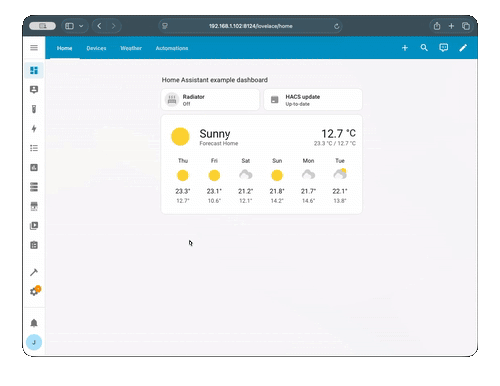

# Quickstart

This guide will help you get Navbar Card up and running in your Home Assistant dashboard in just a few minutes.

## Adding the card to your dashboard

Once you've [installed Navbar Card](installation.md), adding it to your dashboard is straightforward:

1. Open your dashboard in **edit mode** (click the pencil icon in the top right)
2. Click the **"Add Card"** button (+ icon)
3. Search for **"Navbar Card"** in the card picker
4. Select it to add to your dashboard

!!! tip "Auto Configuration"

    The card comes with a default configuration that includes common routes (Home, Devices, Automations, Settings and More), so you can start using it right away!

---

## Video tutorials

Our community has created some excellent video tutorials to help you get started:

### First steps with Navbar Card

Learn the basics of setting up and configuring the card:

<iframe 
    width="560"
    height="315"
    src="https://www.youtube.com/embed/qZ3aoDeG3e8"
    title="Getting Started with Navbar Card"
    frameborder="0"
    allow="accelerometer; autoplay; clipboard-write; encrypted-media; gyroscope; picture-in-picture; web-share" 
    allowfullscreen
>
</iframe>

### Visual editor overview

A comprehensive guide to using the new visual editor introduced in version 1.0.0:

<iframe 
    width="560"
    height="315"
    src="https://www.youtube.com/embed/2ZY7gu6bnxA"
    title="Navbar Card Visual Editor Guide"
    frameborder="0"
    allow="accelerometer; autoplay; clipboard-write; encrypted-media; gyroscope; picture-in-picture; web-share" 
    allowfullscreen
>
</iframe>

## Next steps

- Check out our [Configuration Guide](../configuration/overview.md) for detailed options
- Browse the [Examples Gallery](../examples.md) for inspiration
- **Need help?** Check out the [FAQ](../help/faq.md) or [Contact](../help/contact.md) channels for help and tips
